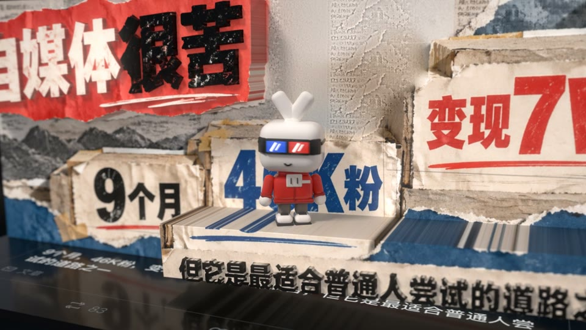
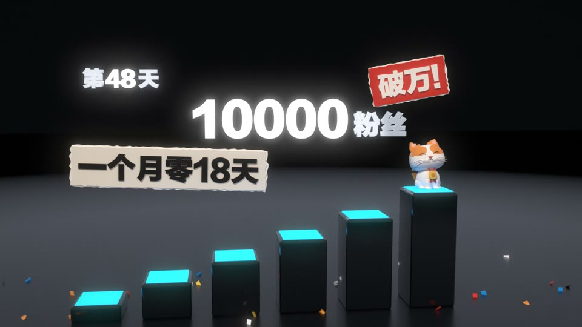
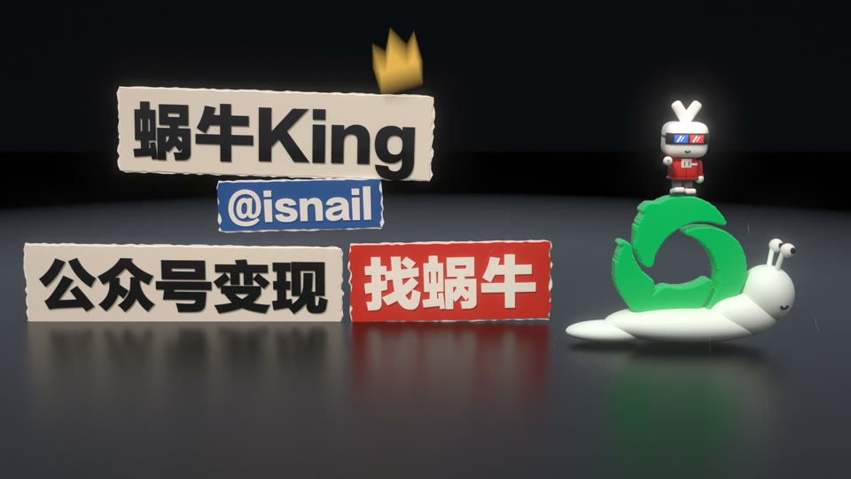
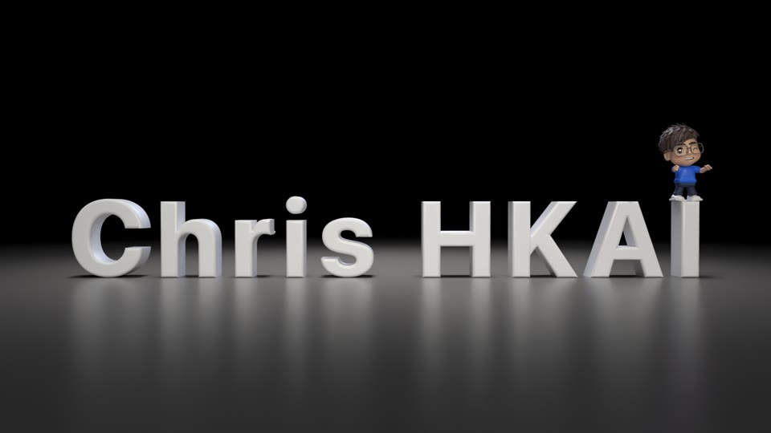

<div align="center">

# ChrisHKAI-Video

**Paste a creator's X link, get a short film starring them as a 3D vinyl toy.**<br>
Their profile picture peels off the page and puffs into a toy of them; their best posts stand up as walls; their numbers rise out of the page.<br>
<sub>A video skill for coding agents, made entirely in code · 🇨🇳 中文用户请看 <a href="README.zh-CN.md">简体中文说明</a></sub>

<a href="https://github.com/ChrisHKAI/ChrisHKAI-Video/releases/tag/films"></a> <a href="README.zh-CN.md"></a> <a href="#help-test-it"></a> <a href="https://github.com/ChrisHKAI/ChrisHKAI-Video/stargazers"></a> <a href="#licence"></a>

⚠️ **Built for Claude.** Testers ran it with Claude Opus 5.5 and Sonnet 5.5 at high effort; xhigh does better.<br>
Other models and agents are untested, so use them with care.

🆕 **2026-10-29 · Your story first**: three testers' films taught us a lot. The film now starts from what the creator is known for, the toy keeps the body its picture has (a lemon gets no arms), you pick one of three openings, and a check says what will break before Blender starts. [See how ↓](#what-happens)<br>
🧪 **2026-10-28 · Open for testing**: the first film for a real creator is done and approved. Now I'd like to see it run on your computer. [How to help ↓](#help-test-it)<br>
🆕 **2026-10-28 · Sound by ear**: hear six sounds under the animatic and pick one, put the creator's own song on the film's beat, or play it on real sampled instruments. [See how ↓](#the-sound)<br>


<sub>Official repo: [github.com/ChrisHKAI/ChrisHKAI-Video](https://github.com/ChrisHKAI/ChrisHKAI-Video) · by Chris ([@ChrisHKAI](https://x.com/ChrisHKAI))</sub>

</div>

## 🎬 Feature presentation

<table><tr>
<td width="50%" valign="top"><a href="https://github.com/ChrisHKAI/ChrisHKAI-Video/releases/download/films/isnail-intro.mp4"></a><br><b>▶ 蜗牛King</b> · @isnail · 0:30<br><sub>His avatar peels off and pops into his vinyl mascot; his posts stand up as walls and 304万 reads rise out of the page. The film the skill was extracted from.</sub></td>
<td width="50%" valign="top"><a href="https://github.com/ChrisHKAI/ChrisHKAI-Video/releases/download/films/kingao-intro.mp4"></a><br><b>▶ Kin</b> · @KinGao476942 · 0:30<br><sub>Starring his calico cat as a vinyl toy, climbing from 50 followers on day 3 to 10,000 on day 48.</sub></td>
</tr></table>

<div align="center">

Both films are code from the first frame to the last note: Blender renders the picture, Python writes the sound.<br>
[**▶ All films**](https://github.com/ChrisHKAI/ChrisHKAI-Video/releases/tag/films) · [**How each was made**](examples/README.md)

</div>

## 👋 About me

I'm **Chris** ([@ChrisHKAI](https://x.com/ChrisHKAI)), from Hong Kong. I share what I build with AI on X.

> **Not a template pack.** Every film here was made by me with a coding agent, in code.<br>
> The skill is tuned for Claude Opus 5.5; other models may not get there.

Every film is directed, built, scored and rendered by an agent writing code:

- 🧸 **Toy**: built from a part list, a pet kit or a sculpt of signed distance fields, from a picture you confirm
- 🎨 **Picture**: the profile page is HTML; the scene is Blender Cycles, rendered frame by frame
- 🎵 **Sound**: synthesized in Python, played on free sampled instruments, or the creator's own song cut to the film's beat

No video generation, no image generation, no stock footage. The profile picture, the posts and the numbers are the creator's own.

## How to use

Two ways in; the plugin is the easiest.

### Option 1: install the skill (recommended)

In your terminal:

```sh
claude plugin marketplace add https://github.com/ChrisHKAI/ChrisHKAI-Video.git
claude plugin install chrishkai-video@chrishkai-video
```

The full `https://` address needs no SSH key; the download is about 2 MB. If it still fails (a slow or blocked connection to GitHub), download it yourself and add the folder:

```sh
git clone --depth 1 https://github.com/ChrisHKAI/ChrisHKAI-Video.git
claude plugin marketplace add ./ChrisHKAI-Video
claude plugin install chrishkai-video@chrishkai-video
```

Then use it from any folder.

- Each film gets its own workspace, `<handle>-intro/`, in the folder you started from.
- Blender, the Python modules and headless Chrome go in user-level folders (`~/Applications`, `~/.chrishkai-video`, `~/.cache/puppeteer`), and only after you say yes.
- For other agents, copy [`skills/creator-toy-intro/`](skills/creator-toy-intro/) into their skills folder.

### Option 2: clone the repo

```sh
git clone https://github.com/ChrisHKAI/ChrisHKAI-Video.git
mkdir my-films && cd my-films
claude --plugin-dir ../ChrisHKAI-Video
```

Films go into `my-films/`, outside the repo.

### Then just say what you want

> Make a self-intro film for https://x.com/yourhandle

> 帮我做一条自我介绍片：https://x.com/yourhandle

> 幫我整條自我介紹片，主角係我個公仔：https://x.com/yourhandle

A link, a share message pasted from the app or a few screenshots all work. Not sure yet? Type `/chrishkai-video:creator-toy-intro` and nothing else; it asks for the link.

It answers in your language and asks you one thing up front: 16:9 (the X desktop page, recommended) or 9:16 (the X phone page). The rest it works out from the profile.

### What happens

Six steps, and each ends on something you look at.

| step | what it does | where it stops for you |
|---|---|---|
| **0 · the computer** | checks Blender, Node, Python, ffmpeg and Chrome; one yes installs what is missing | the install list, if anything is missing |
| **1 · your link** | reads the link and opens the film's workspace | 16:9 or 9:16 |
| **2 · their story** | what the creator is known for and proud of, each with its pictures, its numbers (today's, with where they were read) and the animation it becomes; with Grok Build it also searches X | which picture the toy is made from; then one page: pick two or three story points, one of three openings, the ending, each with a preview |
| **3 · the toy** | builds the toy with the body its picture has (a person, an animal, an object) in one of three kits: a part list, a pet, a sculpt | a turnaround to approve, its colours already checked on the dark stage |
| **4 · the storyboard** | the film's pieces in the order you picked, the beat grid, real preview renders, every sound under the animatic | the storyboard page: leave notes on the frames, pick the sound, sign off |
| **5 · the render** | a few seconds at full quality first, then a quick half-size version if you like, then the film, an effects-only cut, covers for each platform, a last look | the finished film |

Nothing is a template filled in: when your material wants an animation the skill doesn't have yet (your illustrations as a little 3D world, a page scrolling past), the agent writes it for your film.

Before you sign off, the storyboard page checks the film for you:

- **Pace**: quiet stretches, the toy left alone too long or too small to see, the first three seconds, and whether every line stays up long enough to read.
- **It won't break**: `check` reads everything before Blender starts and says what is wrong in plain words; the full render waits until the page is clean and you have signed off.
- **Colour**: every word must read on the dark stage; the palette comes from the creator's own pictures.
- **Solid things stay solid**: the toy never walks into a wall, stands inside what pushes out of it, or has a label slide through it. It makes way by itself, and `clearance` checks every frame before Blender.
- **As good as the approved films**: `compare` puts your film's opening, toy, proof, payoff and end card beside three films that were approved, and the agent fixes what falls short. Before the hours of the full render, `sample` renders the riskiest few seconds at full quality with sound.
- **Not the last film again**: each film you deliver is kept in a ledger, with the skill's own films in it from the start, and a new one must differ from every one of them in at least four of six things (the opening, the structure, the signature move, the colours, the sound, the ending).
- **A second opinion**: a fresh reviewer reads the brief and the frames. Where it disagrees, you get its view as one more option, not a rule.

Story selection first offers up to three complete directions and recommends one:
each has an opening hook, connected facts, a payoff and any evidence gaps. One
targeted follow-up can fill important gaps (with Grok, one more search). Thin evidence leads to a narrower story, never an invented turning point.
Existing projects can still select individual material points as before.

The chosen direction then gets a quick text-only story test: what viewers
remember, why they keep watching, what makes this creator distinctive, and what
each major toy action communicates. It is advice, never a gate: it adds no
question for you and doesn't hold up the toy. The actual animation is still
checked in the storyboard and final review.

### The sound

You pick the sound by ear: `run.mjs listen` lays each one under the animatic.

| sound | what it is |
|---|---|
| `bed` (default) | the effects over a quiet layer of long chords |
| `song` | the template's full synthesized song |
| `band` | the song on real instruments |
| `strings` | the bed on a real string section and a piano |
| `fx` | the effects alone |
| `own` | the creator's own song, put on the film's beat |

`band` and `strings` need the sample libraries, about 1.4 GB, downloaded only on your yes.

### Before you start

- **It takes a while, and a lot of tokens.** A film is hours of work, not minutes: research, a toy, a storyboard you sign off, then a Cycles render that runs for an hour or more in the background (about 1.5 h on an M4 Pro or M5). High effort works; xhigh does better.
- **Tested on a Mac with Apple silicon**, in Claude Code with Claude Opus 5.5. Windows and Linux are not tested yet; Intel Macs can't run Blender 5.2.
- **You need** Blender 5.2+, Node 22+, Python 3.9+, ffmpeg and headless Chrome. The skill checks them and installs what is missing on your yes; anything that needs your password, you paste into Terminal yourself. If `node` itself is missing, install Node 22 first.
- About **10 GB free** for each film, and a **GPU**: without one, Cycles takes hours.
- The agent must be able to **look at images** (every check is a picture) and use a **browser** for the research.
- **Optional**: [Grok Build](https://x.ai) to search X (a search costs roughly US$1–1.4), and the real instruments (about 1.4 GB).
- **Output**: 1920×1080 or 1080×1920 at 30 fps; 30 s by default, longer when there is more to say. This release publishes on X; 抖音, 小红书, 视频号 and Instagram come one per later release.

### Update or uninstall

Update, then restart Claude Code:

```sh
claude plugin marketplace update chrishkai-video && claude plugin update chrishkai-video@chrishkai-video
```

Uninstall:

```sh
claude plugin uninstall chrishkai-video@chrishkai-video
```

Then delete `~/.chrishkai-video` (the Python modules, fonts, instruments and the ledger of your films) if you don't want it. Blender in `~/Applications` and Chrome in `~/.cache/puppeteer` are yours to keep or remove. Your film workspaces stay where they are.

If a step stays stuck, [open an issue](https://github.com/ChrisHKAI/ChrisHKAI-Video/issues).

## Help test it

The skill is in its testing stage: one film for a real creator is done. I can't try every computer and every model myself, so I'd love to hear how it runs for you. [Open an issue](https://github.com/ChrisHKAI/ChrisHKAI-Video/issues) with:

- the agent, the model and the effort;
- your computer (chip, system, GPU);
- where it got stuck or what looked wrong (a frame or a screenshot of the storyboard page helps);
- the film, if you're happy to share it.

Tested so far:

| agent | model | effort | computer | result |
|---|---|---|---|---|
| Claude Code | Claude Opus 5.5 | xhigh | Mac, Apple silicon | [铁柱AGI's 42 s film](https://github.com/ChrisHKAI/ChrisHKAI-Video/releases/download/films/cgnot996-intro.mp4), approved |
| Claude Code | Claude Opus 5.5 | high | M4 Pro | a 32 s film, unattended, in about 2.5 h; the review found act 3 long and still |
| Claude Code | Claude Sonnet 5.5 | high | M4 Pro | a 32 s film, unattended, in about 1.5 h; one number from an old post (fixed) |
| Claude Code | Claude Opus 5.5 + Haiku | high | M5 | a 30 s film; six crashes on the way and a weak film: all fixed since, and the lessons below |

## The films

Every film made before and alongside the skill. Click a frame to watch; each film's brief and code are in [`examples/`](examples/README.md).

<table><tr>
<td width="50%" valign="top"><a href="https://github.com/ChrisHKAI/ChrisHKAI-Video/releases/download/films/cgnot996-intro.mp4"></a><br><b>▶ 铁柱AGI</b> · @cgnot996 · 0:42<br><sub>The first film the skill made for a real creator: a flip calendar to 10,000 followers, 1,500 stars for his Grok App, a 官方认证 seal.</sub></td>
<td width="50%" valign="top"><a href="https://github.com/ChrisHKAI/ChrisHKAI-Video/tree/examples/examples/tim-intro"></a><br><b>Steve</b> · from the Tim film<br><sub>Steve Jobs as a vinyl toy on the 2007 keynote stage, beside Tim's toy. The film (2:23) is not published: it carries keynote footage and a song that belong to others. Click for its code.</sub></td>
</tr><tr>
<td width="50%" valign="top"><a href="https://github.com/ChrisHKAI/ChrisHKAI-Video/releases/download/films/isnail-intro.mp4"></a><br><b>▶ 蜗牛King</b> · the end card<br><sub>His mascot rides a snail grown out of the 公众号 mark, while torn-paper labels slap down: 公众号变现 | 找蜗牛.</sub></td>
<td width="50%" valign="top"><a href="https://github.com/ChrisHKAI/ChrisHKAI-Video/releases/download/films/chris-outro.mp4"></a><br><b>▶ Chris HKAI</b> · 0:23<br><sub>An end tag: me as my own sculpted vinyl toy.</sub></td>
</tr></table>

Two more, Merge Conflict and Made with DeepSeek, are on the [Releases page](https://github.com/ChrisHKAI/ChrisHKAI-Video/releases/tag/films).

## Licence

Made by **ChrisHKAI × Claude**.

- **Code and docs**: [MIT](LICENSE).
- **Films you make with the skill**: yours.
- **The creators in the demo films** (the Releases, `docs/` and `examples/`): their profile pictures, posts, names and mascots belong to them.
- **Real instruments**: the sampler is [lemo-opuscar](https://github.com/lemomo-ai/lemo-opuscar)'s, under MIT, in [`engine/vendor/lemo/`](skills/creator-toy-intro/engine/vendor/lemo/). The sample libraries keep their own licences: CC0, except the Salamander Grand Piano (CC BY 3.0) and the MuldjordKit drums (CC BY 4.0). A film that uses them gets a `credits.txt` for its description.
- **No font files**: the end card uses system faces (Lantinghei, PingFang, Helvetica Neue) or the free Source Han Sans. Commercial use of a system face may need a licence from its foundry.

You are responsible for the material you use in your films.

## Thanks

- 🍋 **[lemo-opuscar](https://github.com/lemomo-ai/lemo-opuscar)** by Lemomo: the sampler and sample packs behind the real instruments, and the shape of this page.

---

<div align="center">

⭐ **Star this repo**<br>
👀 **Watch → Custom → Releases** to hear about new versions<br>
𝕏 Follow [@ChrisHKAI](https://x.com/ChrisHKAI)

<sub>ChrisHKAI-Video · by Chris</sub>

</div>
